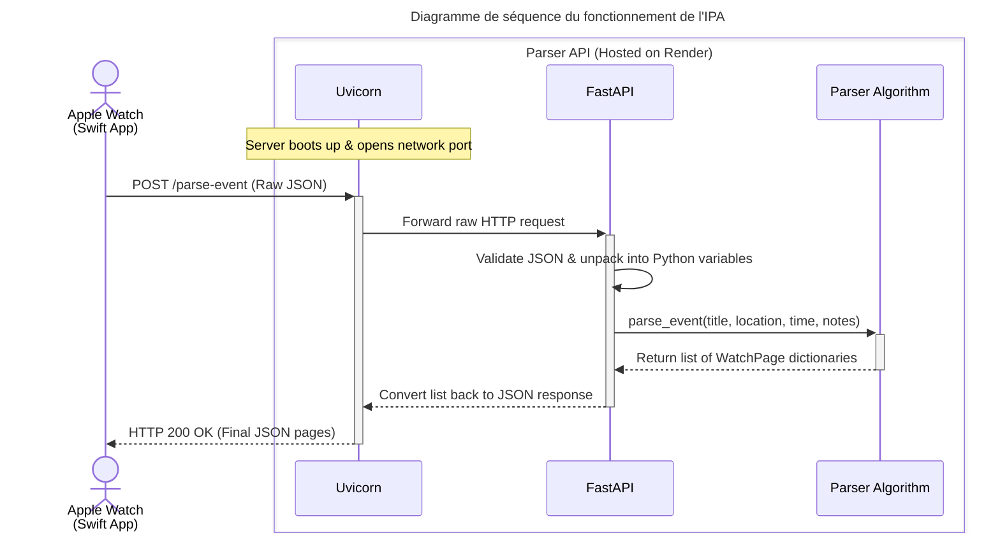

# apple-calendar-event-parser
IPA REST-API qui transforme les informations clés d'un évènement du Apple Calendar (titre, localisation, le start-time et les notes) en petit "morceaux" (pages) qui sont facilement affichables sur une Apple Watch.

Cette IPA est (pour l'instant) uniquement optimiser pour les évènements de cours. 

## Comment ça marche :

La fonction `parse_class_event`... 
- Sépare les notes en listes à puces ou numérotées ;
- Supprime les verbes de remplissage (français et anglais) ;
- Extrait des textes visuels de trois mots maximum ;
- Associe les **symboles SF** d'Apple au étapes et génère des phrases pour `AVSpeechSynthesizer` (press and hold VoiceOver).

(Pour la première page (like the "main" event), c'est l'icône choisi par l'utilisateur qui doit être afficher, donc c'est l'application qui doit le choisir et non l'IPA.)

### Diagramme de séquence :




## Contrat d'IPA :

**Live Endpoint:** `POST https://apple-calendar-event-parser.onrender.com`  
**Interactive Docs:** `https://apple-calendar-event-parser.onrender.com`

> **Attention!!** Comme l'IPA est sur Render gratuitement, il s'éteind tout seul après 15 minutes (environ), donc si c'est la première fois depuis un bout que vous faite un requête, ça peut prendre un peu de temps (parce que le serveur doit se réveiller).

### 1. Corps des requêtes (`application/json`)

| Champ | Type | Requis | Description |
| :--- | :--- | :---: | :--- |
| `title` | `string` | Oui | Nom du cours ou de l'évènement (e.g., `"Calculus I"`). |
| `location` | `string` | Non | Local ou bâtiment (e.g., `"Room B-204"`). |
| `start_time_iso` | `string` | Oui | Doit être dans le format ISO-8601 (ex : `"2026-11-23T14:00:00Z"`). |
| `notes` | `string` | Non | Notes de l'évènement sous forme de liste à puces ou numérotée (`•`, `-`, `*`, `1.`, `2)`). |

#### Exemple de requête :

```json
{
  "title": "Calculus I",
  "location": "Room B-204",
  "start_time_iso": "2026-11-23T14:00:00Z",
  "notes": "• Bring TI-84 calculator\n- Don't forget to pack the blue binder\n1. Open Moodle for practice sheet"
}
```

### 2. Corps des réponses (`200 OK`)
L'IPA retourne des réponses ayant le format suivant ; une liste de dictionnaire (représentant chacun une page).

```json
[
  {
    "displayedText": "10 min",
    "systemIcon": "timer",
    "spokenText": "You have Calculus I in 10 minutes."
  },
  {
    "displayedText": "Room B-204",
    "systemIcon": "door.left.hand.open",
    "spokenText": "Go to Room B-204."
  },
  {
    "displayedText": "TI-84 calculator",
    "systemIcon": "function",
    "spokenText": "Don't forget your calculator: TI-84 calculator."
  },
  {
    "displayedText": "Blue binder",
    "systemIcon": "folder.fill",
    "spokenText": "Pack your folder or notebook: blue binder."
  },
  {
    "displayedText": "Open Moodle",
    "systemIcon": "arrow.up.forward.app.fill",
    "spokenText": "Digital action needed: Moodle for practice sheet."
  },
  {
    "displayedText": "Done",
    "systemIcon" : "checkmark.circle.fill",
    "spokenText" : "That was all of the information about this event."
  }
]
```

## Intégration de l'IPA dans l'appli sur Swift :

Voici un exemple de code swift pour comment l'intégration de l'IPA (c'est du code de Gemini, si ça ne fonctionne pas, désolé... 🧍‍♀️)

```swift
import Foundation
import EventKit

struct WatchPage: Codable, Identifiable {
    var id: UUID { UUID() }
    let displayTitle: String
    let systemIcon: String
    let spokenText: String
}

struct EventPayload: Codable {
    let title: String
    let location: String
    let start_time_iso: String
    let notes: String
}

func parseEvent(event: EKEvent) async throws -> [WatchPage] {
    guard let url = URL(string: "https://onrender.com") else {
        throw URLError(.badURL)
    }
    
    let formatter = ISO8601DateFormatter()
    let payload = EventPayload(
        title: event.title ?? "Event",
        location: event.location ?? "",
        start_time_iso: formatter.string(from: event.startDate),
        notes: event.notes ?? ""
    )
    
    var request = URLRequest(url: url)
    request.httpMethod = "POST"
    request.setValue("application/json", forHTTPHeaderField: "Content-Type")
    request.httpBody = try JSONEncoder().encode(payload)
    
    let (data, _) = try await URLSession.shared.data(for: request)
    return try JSONDecoder().decode([WatchPage].self, from: data)
}
```

## Testing de l'IPA en local :

Voici les étapes pour faire des tests en local (je veux dire, sans le serveur, tester le parser en tant que tel) :

1. Cloner le repo et installer les dépendances 
   ```bash
   pip install -r requirements.txt
   ```
2. Lancer les tests déjà fait (Vous pouvez aussi ajouter vos propres tests)
   ```bash
   python test_parser.py
   ```
   

